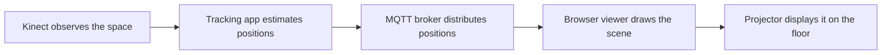

# NABA · Interactive Floor Projection

**Social Design · 27 November 2026**

Today we defined a shared architecture for turning movement in a physical space into projected graphics. We built several browser sketches that respond to the same position messages. This makes it possible to keep one tracking setup and switch between different interactions by opening a different viewer.

## From the Kinect to the floor

1. **Tracking.** The Kinect is the planned input for the installation. The tracking application identifies people in the space and converts their positions into two normalized coordinates. Each person gets a separate numerical ID so the viewer can follow their position over time.
2. **Communication.** The input application publishes positions to an MQTT broker. A position message says where a person is. Each browser viewer decides what to do with that information.
3. **Visualization.** The viewer fills the browser window. We connect the projector as a display and point it at the floor. On a roughly rectangular projection, the viewer uses the whole image as its drawing area. During setup, check the corners and axis directions so positions in the tracking area correspond to positions on the floor. A simple alignment test is enough to start experimenting.

The browser sketches and their test controls are available now. For the installation, the Kinect tracking app needs to publish the agreed MQTT messages and be checked against the actual projector setup.

## The shared position format

| What | Example |
| --- | --- |
| Topic for person 1 | `naba/position/1` |
| Topic for person 2 | `naba/position/2` |
| Viewer subscription | `naba/position/+` |
| Plain-text message | `0.25 0.70` |

The first number is **x**, from left to right. The second is **y**, from top to bottom. Both range from 0 to 1. For example, `0.25 0.70` means a quarter of the way across the image and 70% of the way down. Keep the same topic for a person while tracking them, and send regular updates while they are in the space. Multiple viewer tabs can receive the same positions at the same time.

## What we built

| Open a viewer | What it projects |
| --- | --- |
| [Agar Viewer](https://marcobrianza.github.io/mqtt-websocket-test/agar-viewer.html) | A circle for each person. When circles meet, they form a larger circle and send bands of their colors outward. When people move apart, the circles separate again. |
| [Rainbow Viewer](https://marcobrianza.github.io/mqtt-websocket-test/rainbow-viewer.html) | A color strip along the bottom. Walk into a swatch to pick up its color and carry it back into the projection. |
| [Rainbow Viewer Trails](https://marcobrianza.github.io/mqtt-websocket-test/rainbow-viewer-trails.html) | The same color strip with a drawing surface. Each moving circle leaves a line in its selected color. The drawing stays until you clear it or reload the page. |
| [Cat Paw Trails](https://marcobrianza.github.io/mqtt-websocket-test/cat-paw-trails.html) | Alternating left and right paw prints turn in the direction of travel. Each cat avoids overlapping its own visible prints, and different cats' tracks can cross. Prints hold for 10 seconds, then fade over 3 seconds. |
| [Emoji Trails](https://marcobrianza.github.io/mqtt-websocket-test/emoji-trails.html) | Seven changing slots hold animals, food, plants, and objects. Pick up an emoji and carry it across the floor to stamp a trail. A used slot goes blank for 3 seconds before it refills. Stamps turn with movement and fade on the same timing as the paw prints. |

## Try it without the Kinect

1. Open any viewer and use its **Test** button. In Rainbow Viewer Trails, Cat Paw Trails, and Emoji Trails, click twice to pick up a color or icon and move into the drawing area.
2. For live testing, open the [MQTT debugger](https://marcobrianza.github.io/mqtt-websocket-test/debug.html) in a second tab. Publish `0.50 0.94` to `naba/position/1`, then `0.50 0.50` to the same topic. In Emoji Trails, this picks up an emoji near the bottom and stamps a trail toward the center.
3. Try publishing a second position on `naba/position/2`. Open two viewers side by side to see how the same positions produce different interactions.
4. When projecting, click **Fullscreen**. Press **H** to bring the controls back.

The same position stream can support a new floor interaction without changing how the Kinect tracks people. The rules for what appears, changes, or disappears live in each viewer.
